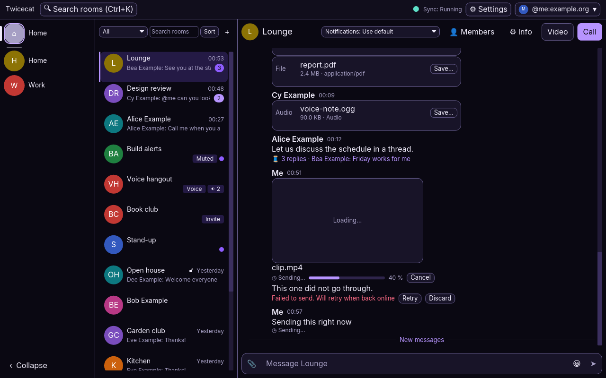
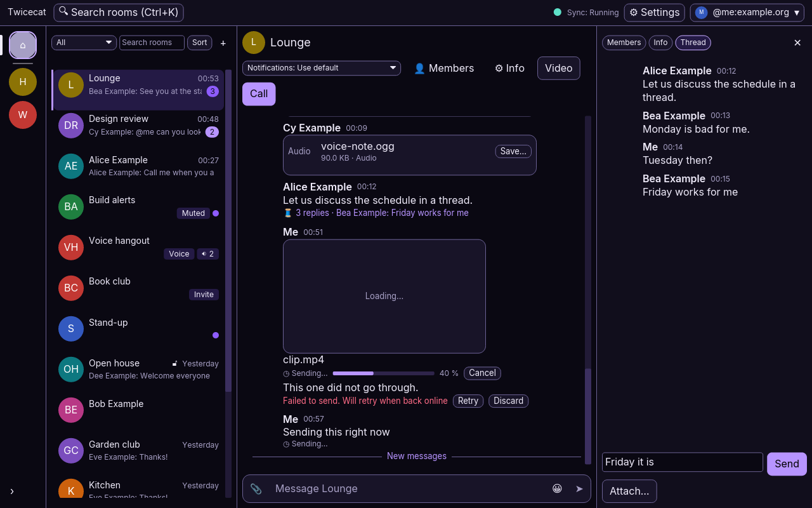

# Evidence — Task 10: wider, collapsible spaces rail with names
Commit: 17188c1
Environment: CC=clang-22 CXX=clang++-22; gallery via `TWICECAT_GALLERY_DIR=<scratch> TWICECAT_GALLERY_ONLY=main-rail cargo test -p twicecat-app --test ui_gallery write_the_gallery -- --ignored` (headless renderer, no Docker, no window). All 20 main-rail-* PNGs (5 scenes x 2 themes x 2 densities) were written; the twicecat/comfortable variant of each was viewed. Two kept beside this file.

## Rail is 200 px expanded (icon + name per row, default), names visible without hover
Status: PROVEN (rendered image; real window is human-only)
Viewed main-rail-expanded-1280 and -1920 (twicecat-comfortable). Left rail is a 200 px column: each row shows the round icon with its name to the right ("Home" for the home glyph, "Home" for the H space, "Work"), with no hover. Selected row (home) has the lighter highlighted icon and the accent bar at the left edge; a separator line sits under the home row. Nothing clipped or overlapping; the room list (300 px) and room pane follow. At 1920 the same 200 px rail, the room pane just grows.

Note: the two rows both read "Home" because of the scenario data (home entry plus a space named Home), not a rendering fault.

## Collapse control at the bottom (chevron + "Collapse")
Status: PROVEN (image)
In both expanded images the bottom-left of the rail shows "‹ Collapse", aligned with the name column, not overlapping anything.

## 72 px collapsed rail (icon only, names in tooltips) with chevron expand control
Status: PROVEN for layout (image); tooltip text NOT PROVEN visually (hover is human-only; covered by wide_rail tests below)
main-rail-collapsed-1280 and -1920: rail is the narrow icon-only column (icons H, W, home, no names), room list starts at ~72 px; bottom-left shows a lone "›" chevron, no label. No clipping.

## Unread badge visible
Status: NOT PROVEN visually
In none of the viewed images is an unread badge visible on any space icon/row (scenario shows no badge on H or W). Badge drawing is covered only by unit tests (the_rail_marks_read_on_the_rail_background...). Flagged as a gap in the gallery scenario, not a failure.

## Panel-open at 1280 collapses the rail (room pane keeps >= 480 px)
Status: PROVEN (image)
main-rail-panel-open-1280: with the Thread panel open on the right (~340 px) the left rail is the 72 px icon-only one with the "›" expand chevron, matching the rule that the wide rail needs the room pane to keep >= 480 px. The room pane header wraps (Notifications select, Members, Info, Video, then Call on a second row) but nothing is clipped or overlapping; messages and the composer are intact. The wrapping header is the room pane's own narrow-layout behaviour.


## Choice flips and persists via ui_settings.spaces_rail + save_local; wide rail only when Expanded, window >= 1100 and room pane >= 480 (pure rail_expanded_shown, never saves); room_pane_width follows the width shown
Status: PROVEN by tests (outside surface only partly reachable); restart persistence is human-only
```console
$ cargo test -p twicecat-app --lib spaces_rail
test state::tests::spaces_rail::an_app_started_collapsed_lays_out_the_72_px_rail ... ok
test state::tests::spaces_rail::a_narrow_window_shows_the_collapsed_rail_and_keeps_the_choice ... ok
test state::tests::spaces_rail::the_room_pane_gives_up_the_width_of_the_rail_shown ... ok
test state::tests::spaces_rail::the_toggle_saves_collapsed_then_expanded_and_changes_nothing_else ... ok
test state::tests::spaces_rail::the_rail_starts_expanded ... ok
test state::tests::spaces_rail::the_toggle_does_nothing_while_a_layer_covers_the_rail ... ok
test state::tests::spaces_rail::the_width_rule_collapses_the_rail_without_saving_anything ... ok
test result: ok. 7 passed; 0 failed

$ cargo test -p twicecat-app --lib rail_   (layout rows)
test layout::tests::the_wide_rail_is_shown_when_the_choice_the_width_and_the_room_pane_allow ... ok
test layout::tests::the_wide_rail_needs_exactly_480_px_for_the_room_pane ... ok
test result: ok. 57 passed; 0 failed   (whole filtered set)
```
Plus wide_rail:
```console
$ cargo test -p twicecat-app --test ui_gallery wide_rail
test wide_rail::a_held_key_does_not_repeat_the_toggle ... ok
test wide_rail::hostile_and_long_names_are_cleaned_capped_and_stay_inside_the_wide_rail ... ok
test wide_rail::no_tab_stop_is_drawn_for_the_control_while_a_dialog_covers_the_rail ... ok
test wide_rail::a_width_that_collapses_the_rail_shows_the_icon_rail_and_the_expand_tooltip_control ... ok
test wide_rail::the_collapse_control_is_a_tab_stop_after_the_last_rail_item ... ok
test wide_rail::enter_on_the_focused_control_flips_the_choice_and_a_click_does_too ... ok
test wide_rail::the_wide_rail_names_each_space_and_the_narrow_one_leaves_the_names_to_tooltips ... ok
test wide_rail::every_slot_is_48_px_high_at_both_widths ... ok
test wide_rail::the_rail_slot_is_as_wide_as_the_rail_shown_and_the_room_pane_keeps_its_place ... ok
test result: ok. 9 passed; 0 failed
```
The width-rule test name "the_width_rule_collapses_the_rail_without_saving_anything" shows the pure rule never saves; the toggle test shows the save.

## Drag-and-drop zones give the same answers at both widths
Status: PROVEN
```console
$ cargo test -p twicecat-app --test ui_gallery the_drop_cases
test rail_reorder_drag::the_drop_cases_give_the_same_answers_with_the_rail_at_either_width ... ok
test result: ok. 1 passed; 0 failed
```

## Hostile names are cleaned and capped
Status: PROVEN by test (no hostile-name PNG scenario exists among main-rail-*; none generated)
`wide_rail::hostile_and_long_names_are_cleaned_capped_and_stay_inside_the_wide_rail ... ok` (above).

## Not covered here (human-only)
Real window rendering, actual hover tooltips, clicking the control, and that the choice survives an app restart (needs saved settings on a real run).

## Verdict
EVIDENCE: PROVEN (with the unread-badge visual not shown in any gallery image)
