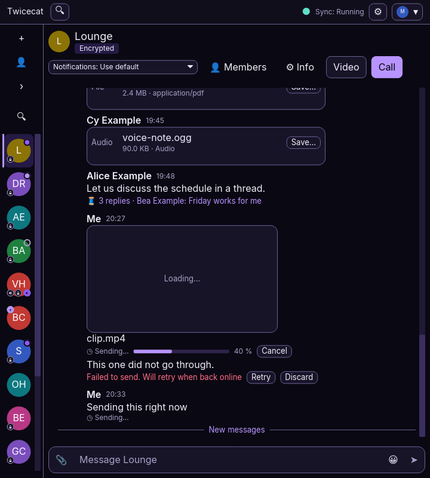

# Evidence — Task 6: labelled panel toggles and notification menu in the room header
Commit: 3e26c24
Environment: CC=clang-22 CXX=clang++-22; cargo tests plus the headless gallery renderer (write_the_gallery, --ignored). Real window is human-only. Full gallery PNGs are in the session scratchpad; one is kept beside this file.

## Members and Info toggles with icon and word, Members shows the count when known; icon + tooltip only below 480 px
Status: PROVEN (words, count and the 480 px rule by test and render); the icon-only render is NOT PROVEN visually (see note)

```console
$ cargo test -p twicecat-app -- the_header_keeps_its_words the_members_toggle the_header_menu_says every_header_action the_call_button_presses a_big_room_builds
test screens::main_view::tests::the_header_keeps_its_words_down_to_a_width ... ok
test screens::main_view::tests::the_members_toggle_shows_the_count_when_known ... ok
test screens::main_view::tests::every_header_action_sends_what_the_old_header_sent ... ok
test screens::main_view::tests::the_call_button_presses_are_still_reachable ... ok
test notifications::tests::the_header_menu_says_what_it_sets ... ok
test dialogs::a_big_room_builds_one_page_of_rows_and_offers_more ... ok
(all: 0 failed)
$ TWICECAT_GALLERY_ONLY=main-room cargo test -p twicecat-app --test ui_gallery -- --ignored write_the_gallery
test write_the_gallery ... ok
$ TWICECAT_GALLERY_DIR=<scratch> cargo test -p twicecat-app --test ui_gallery -- --ignored write_the_gallery   (full, incl. 720 px case)
test write_the_gallery ... ok   (main-narrow-room-*.png written)
```
Test asserts header_labels(1920)=true, (480)=true, (479)=false, (320)=false; members_label gives "Members", "Members (12)", "Members (500+)". Rendered 1280 px header (main-room-twicecat-comfortable.png) shows "Members" and "Info" with icons beside Video/Call; 720 px render is task-6-header-720.png (same words, since the room pane is still over 480 px there). Note: no gallery case renders a pane under 480 px, so the icon-only look and the tooltip are covered by the header_labels test only. Stacked wrapping not separately checked. The fixture room had no member list loaded, so the "(count)" render is by test only.

## Notification menu shows "Notifications: ..." via HeaderMode, through kit::menu, still sends RoomModeChosen(ModeChoice); Info tab reads the same
Status: PROVEN

```console
$ grep -n "notification_menu\|HeaderMode(" crates/app/src/screens/*.rs
main_view.rs:350:        controls.push(notification_menu(app, &room.id));
main_view.rs:451:pub(crate) fn notification_menu<'a>(app: &'a App, room: &RoomId) -> Element<'a, Message> {
main_view.rs:456:            Some(HeaderMode(app.room_mode_choice(room))),
main_view.rs:457:            |mode| Message::RoomModeChosen(mode.0),
room_settings.rs:21:use crate::screens::main_view::notification_menu;
room_settings.rs:122:        notification_menu(app, &room.id)  [as: notification_menu(app, &panel.room)]
```
Test the_header_menu_says_what_it_sets passed (labels "Notifications: All messages", "...: Mentions and keywords", "...: Mute", "...: Use default"; HeaderMode::ALL zipped to ModeChoice::ALL). The render shows the closed menu "Notifications: Use default". The menu is built with kit::menu and maps to Message::RoomModeChosen(mode.0); the Info tab calls the same function.

## Header test listing every reachable message still covers TogglePanel, every CallButton::press, Accept, Decline, Verify
Status: PROVEN

every_header_action_sends_what_the_old_header_sent (cases Members, Settings, People=CallMessage::TogglePanel, Verify, Accept, Decline) and the_call_button_presses_are_still_reachable both passed (output above).


